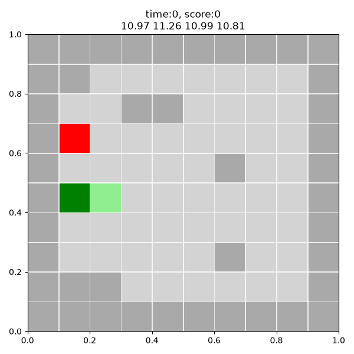
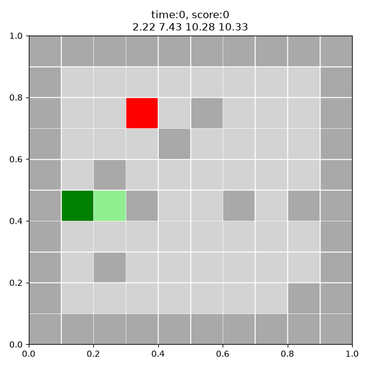
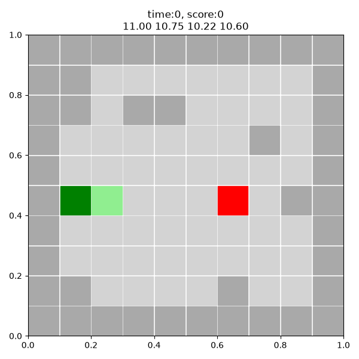
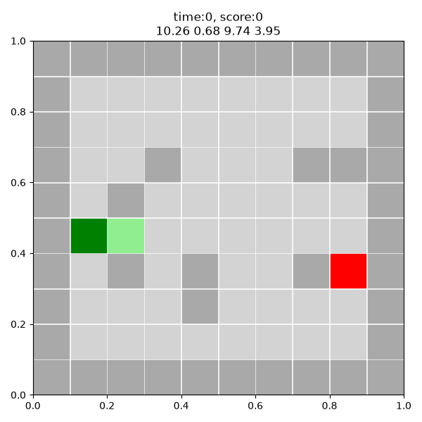

# Snake Reinforcement Learning (PyTorch)

PyTorch port of [snake-rl](https://github.com/DragonWarrior15/snake-rl) by [DragonWarrior15](https://github.com/DragonWarrior15).
The original project was written in TensorFlow. In this fork, the Deep Q-Learning agent and the training code were moved to PyTorch.

This project trains a Deep Reinforcement Learning agent to play Snake.
The agent looks at the last 2 frames of the game and predicts how good each move is, then picks the best one.

---

Sample games from the best performing PyTorch
<br>
<br>



---

## Code Structure

[game_environment.py](game_environment.py) has the Snake game itself, in the Snake and SnakeNumpy classes. It works in a similar way to OpenAI Gym.
A few things to know about SnakeNumpy:

- The games argument sets how many games run at the same time
- If frame_mode is True, the game keeps running and any finished game starts again right away
- The stateful argument of reset decides if the reset is a full one or not

[agent.py](agent.py) has the DeepQLearningAgent class. It uses a CNN written in PyTorch along with a target network.

[model_config/model_17_1.py](model_config/model_17_1.py) has the settings (board size, frames, obstacles and buffer size) and the CNN model.

[training.py](training.py) trains the agent. It only keeps the best model, which is the one with the highest mean reward. The model is saved in the models folder and the training logs go to the model_logs folder.

[game_visualization.py](game_visualization.py) loads the trained model, plays a few games and saves each game as a gif in the [images](images/) folder.

## Usage

Create the conda environment from [completeEnv_gpu.yaml](completeEnv_gpu.yaml), then train the agent and make the gifs:

```
conda env create -f completeEnv_gpu.yaml
conda activate uitnn_gpu
python training.py
python game_visualization.py
```

## Environment with Obstacles

The 10x10 boards are made at random with 8 obstacle cells each, and every board still leaves the snake a way to move around.
You can find the code for this in [obstacles_board_generator.py](obstacles_board_generator.py).<br>
Model v17.1 was trained on these boards. In the sample games above you can see the snake finding its way around the obstacles.